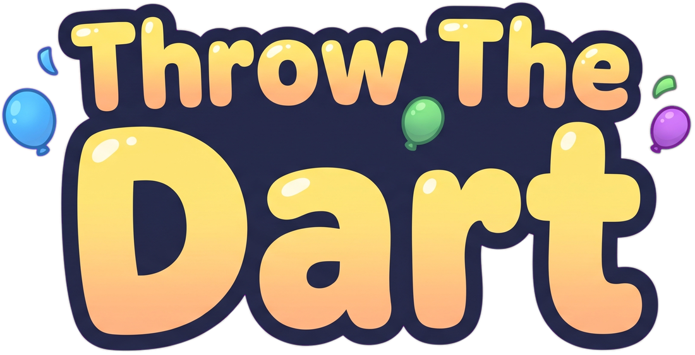
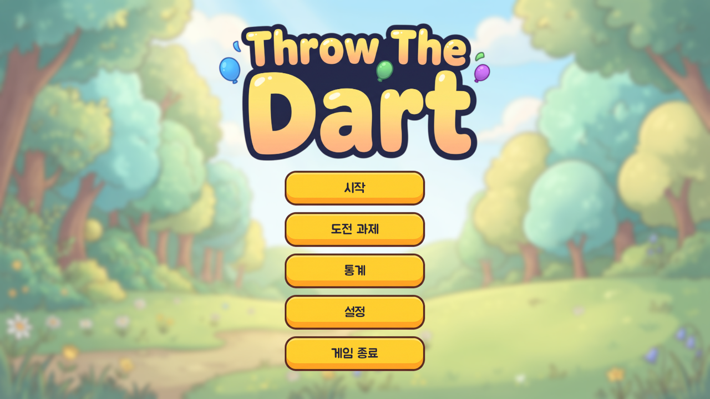
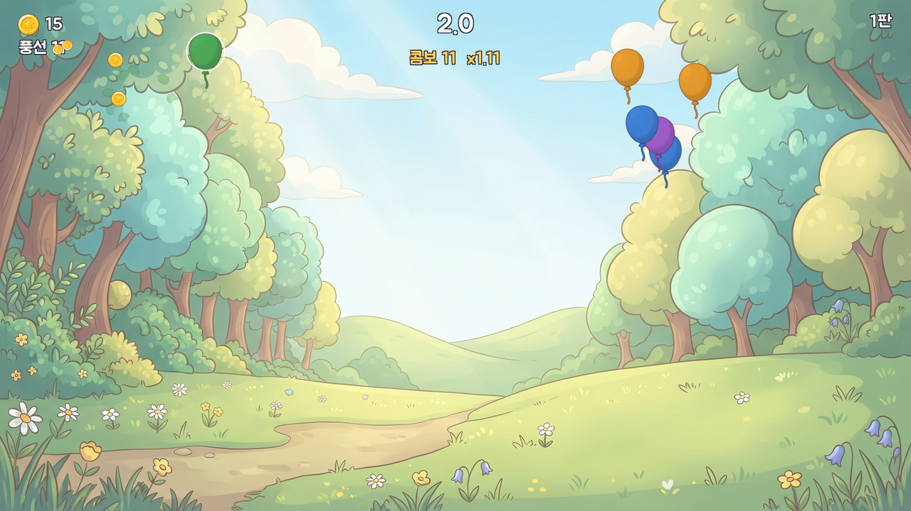
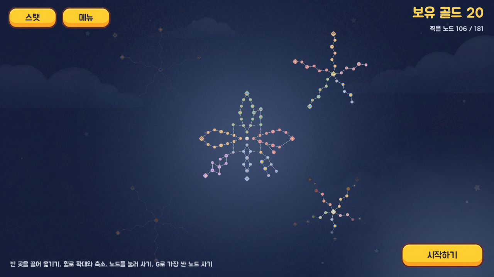
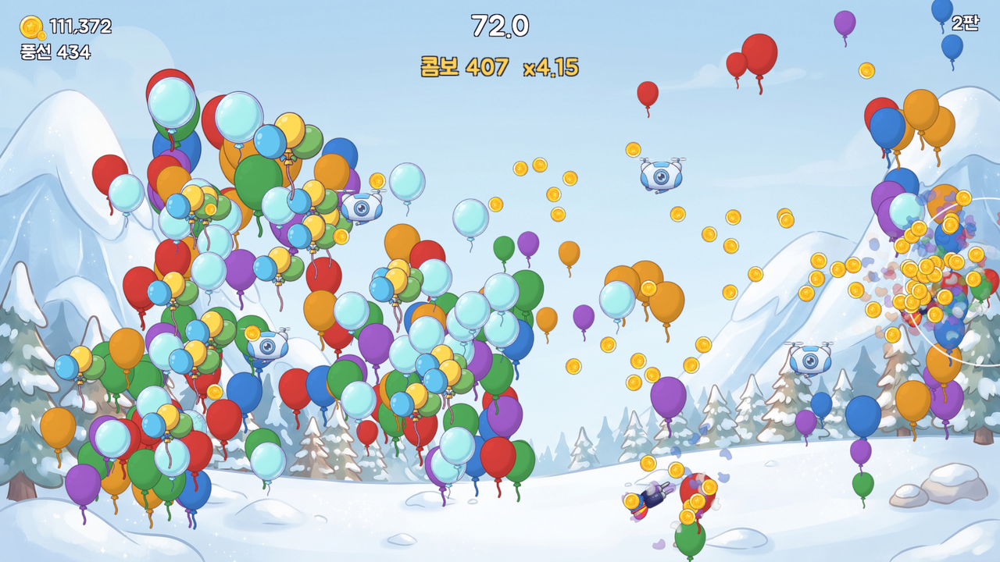
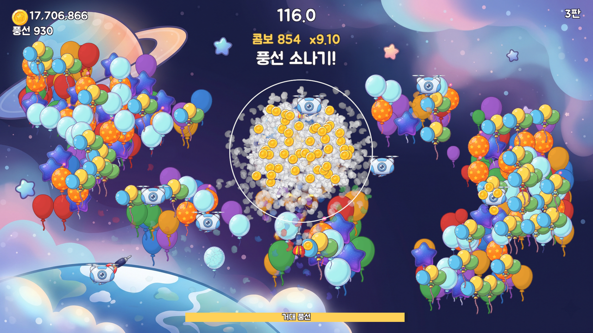
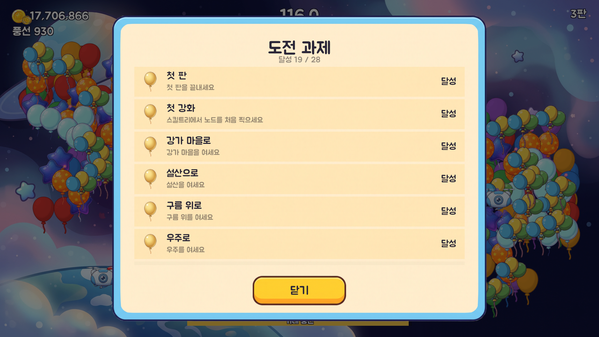

풍선에 다트를 던져 터뜨리고, 모은 골드로 스킬트리를 키워 하늘 끝까지 올라가는 **PC 2D 업그레이드 게임**입니다. (여덟 번째 Unity 2D 게임, Windows)

마우스를 풍선 위에 올리기만 하면 다트가 날아갑니다. 한 판은 짧고, 판이 끝나면 스킬트리에서 강화한 뒤 다시 도전합니다. 숲에서 시작해 강가 마을, 설산, 구름 위를 지나 우주에서 거대 풍선을 터뜨리면 엔딩입니다. 처음부터 엔딩까지 1시간 30분 남짓 걸립니다.

## 특징

- **마우스만으로 하는 조작**: 커서 범위 안의 풍선에 다트가 저절로 날아갑니다. 범위, 던지는 속도, 한 번에 던지는 다트 수, 관통, 폭발을 키울수록 화면이 시원하게 터집니다.
- **스킬트리 182칸**: 숲 하나에서 시작해 지역을 모두 찍으면 다음 지역이 열립니다. 클릭으로 하나씩 고르거나, G를 눌러 가장 싼 노드를 바로 살 수 있습니다.
- **다섯 지역과 특수 풍선**: 지역마다 배경과 음악이 바뀌고, 새 풍선이 나옵니다.
  - 묶음 풍선: 터지면 작은 풍선이 흩어집니다.
  - 얼음 풍선: 두 번 맞혀야 깨집니다.
  - 폭죽 풍선: 주변 풍선을 함께 터뜨립니다.
  - 별 풍선: 잠시 골드를 더 줍니다.
  - 황금 풍선: 화면을 빠르게 가로지르는 값진 풍선입니다.
- **콤보와 풍선 소나기**: 끊기지 않고 터뜨리면 골드 배율이 오르고, 콤보가 쌓이면 풍선이 쏟아집니다. 드론을 얻으면 다트를 대신 던져 줍니다.
- **거대 풍선과 엔딩**: 우주 끝의 거대 풍선을 여러 판에 걸쳐 깎아 터뜨리면 엔딩을 봅니다.
- **도전 과제 28개와 통계**: 색깔별로 터뜨린 풍선, 던진 다트, 최고 콤보 같은 기록을 모아 볼 수 있습니다.
- **한국어, English, 中文**: 처음 켜면 언어를 고르고, 설정에서 언제든 바꿀 수 있습니다.

## 스크린샷

| | |
|---|---|
|  |  |
|  |  |
|  |  |

## 만든 방법

- **엔진**: Unity 6000.3 (URP 2D), Windows
- **화면**: 씬에 놓인 것 없이 모든 화면과 UI를 코드로 만듭니다. 스킬트리 노드는 JSON 데이터로 관리합니다.
- **검수**: 에디터 메뉴의 봇이 판을 직접 돌려 흐름, 저장, 번역, 도전 과제를 확인하고 화면을 찍습니다. 잘하는 봇과 보통 봇으로 처음부터 엔딩까지의 시간을 재어 비용 곡선을 맞췄습니다.
- **그림**: 배경, 풍선, UI는 AI 이미지(Google Gemini)를 받아 워터마크와 배경을 지우고 크기를 맞춰 다듬었습니다.
- **소리**: 효과음(ElevenLabs)과 배경음악(Suno)은 AI 도구로 만들어 편집했습니다.
- **글꼴**: [주아체](https://fonts.google.com/specimen/Jua), [ZCOOL KuaiLe](https://fonts.google.com/specimen/ZCOOL+KuaiLe), SIL Open Font License 1.1

## 문의

skarnd814@gmail.com
